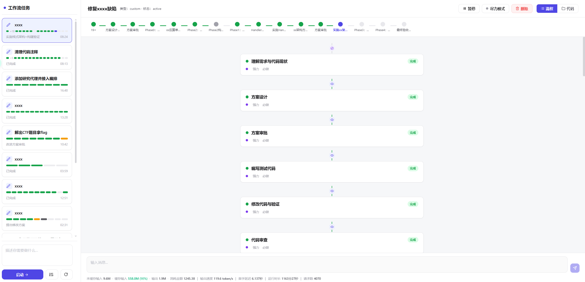

# DimensionCoder

**English** | [简体中文](./README.zh-CN.md)

> A programming tool conceived by humans, implemented entirely by AI

DimensionCoder's **own codebase was written entirely by AI** — humans only provided the ideas, direction, and final decisions, while all implementation was carried out by AI. It is
both a self-practice of the "humans conceive, AI programs" philosophy and an AI coding platform that works the same way: for a user's development task, the human supplies the idea
and approves the plan, and AI automatically breaks it into a structured multi-step flow (DAG), then researches, plans, codes, reviews, and reports step by step, pausing for human
approval at key checkpoints. It manages AI code changes as task cards, with real-time status streaming and file-change management.

It uses a **single-process architecture**: browser → one Python process that simultaneously serves the frontend static assets (`frontend/dist`), the REST API (`/api/*`), and the
SSE event stream (`/sse`). No Node.js at runtime and no separate frontend server.

```
┌──────────┐   HTTP / SSE  ┌────────────────────────────────────────┐
│ Browser  │ ────────────▶ │  Python single process (:8501)         │
│ Desktop/ │ ◀──────────── │  · Serves frontend/dist (static)       │
│ Mobile   │               │  · REST API (/api/*)                   │
└──────────┘               │  · SSE event stream (/sse)             │
                           └────────────────────────────────────────┘
```



## Workflow

The full loop of a task, from "human gives the idea" to "AI delivers and reports":

```
Create task ──▶ AI plans DAG flow ──▶ Execution loop ──▶ Final review ──▶ Flow report
 (preset /                          │
  custom)                           ▼
                    next-step (pick the next step)
                        → prepare (inject role prompt + task context + prior artifacts + key findings)
                        → LLM streaming execution (multi-round tool calls, live SSE push)
                        → step_done (explicit completion, requires a second confirmation self-check)
                        → Monitor orchestration (skip / add / reorder / mark complete, adjusting the DAG)
                        → on a gate step: pause for human approval; if rejected, roll back one step
```

1. **Create a task**: pick a preset task type or a `custom` flow; tasks are managed as cards.
2. **Dynamic orchestration**: based on the task and the "human-approved plan", the Monitor Agent autonomously designs a multi-step DAG with dependencies, ordering, and parallel
   relations, and can adjust the flow at any time during execution.
3. **Step execution**: each step loads its role-specific system prompt and toolset, then streams LLM and tool calls; step status
   flows `pending → active → completed / skipped / stopped`, and artifacts are persisted for later steps to read.
4. **Human approval (Gate)**: Gate steps are inserted at key decision points, where the user can approve / reject / send a guiding message / force-inject an instruction / stop
   execution; a rejection is automatically sent back to the previous step for adjustment.
5. **Quality loops**: plan approval, code review, and final review act as successive checkpoints; a rejection at any of them sends the result back to the relevant step for
   correction.
6. **Wrap-up**: after the final review passes, a structured flow report is produced.

## Features

- **Dynamic DAG orchestration**: structured multi-step flows with built-in default workflows; AI advances the task autonomously from the human-approved plan, and can skip / add /
  reorder steps during execution.
- **Dual-model LLM tiering**: light / power models are routed automatically by step complexity to balance quality and cost; supports OpenAI-compatible APIs and the native Gemini
  protocol, plus an optional second light channel.
- **Memory system**:
  - Flow level: key findings are captured automatically and persistently injected into later steps, full chat history of prior steps is retrievable, and flow reports are
    accumulated.
  - Project level: code flow diagrams are visualized, and project background plus coding conventions (`prompts/rules/`) are injected per step.
- **Intervene at any time**: supports flow-level and step-level intervention — interrupt, pause, resume; intervention modes include sending a message, force-injecting, and stopping
  execution.
- **Multiple loops to ensure quality**:
  - When a plan is rejected, the rejection message is automatically sent back to the previous step to revise the plan.
  - A code-change step must call "step done" twice to finish, ensuring one round of self-check.
  - When an independent code review is rejected, the review result is automatically sent back to the previous step to fix the code.
- **Automatic context management**: context is kept under 400k by auto-summarizing earlier tool-call rounds; Plan files are never discarded; if the limit is truly exceeded, a new
  step is opened to continue (tokens counted deterministically via tiktoken).
- **Toggleable auto-approve mode**: when enabled, recommended plans are approved automatically to reduce waiting.
- **Built-in roles** (11 step types, each with its own prompt and toolset):
  - Plan design: prefer solving the root cause in one place, auto-compare multiple options, and inventory prior plans (`architect` / `plan`).
  - Plan approval: a six-section approval report — plan inventory, current-state & root-cause tables, option list (impact analysis + implementation steps), option comparison, and
    acceptance table, plus a code flow diagram to ease approval (`gate`).
  - Code review: fixed review directions, review categorization, and automatic rejection (`code_review` / `review`).
  - Plus requirement analysis (`requirement`), research (`researcher`), reverse engineering (`reverse`), execution (`executor`), and reporting (`report`).
- **Desktop / mobile interoperability**: a responsive UI lets both desktop and mobile view the flow, approve, and intervene.

### More capabilities

- **Reverse-engineering toolset**: crypto constant extraction (matching MD5/SHA/AES/DES/CRC/RC4/TEA S-boxes), wildcard byte search, angr-based decompilation, and Z3 constraint
  solving.
- **Binary simulator**: Unicorn-engine-driven x86 PE emulation with deobfuscation, symbolic execution, and Windows API stubs.
- **MCP tool extension**: connect stdio / http MCP servers via `mcpServers` to dynamically extend tool capabilities.
- **Security & transport**: optional HTTPS/TLS; optional "SSH-style key login" (ECDSA P-521 public-key challenge verification + sessions).
- **Real-time streaming + built-in editor**: SSE pushes streaming text, tool calls, and reasoning; includes a Monaco code editor, file-tree browsing, and code-flow-diagram
  rendering.

## Tech Stack

| Layer | Technology | Version |
|-------|-----------|---------|
| Backend framework | FastAPI | 0.115.0 |
| ASGI server | Uvicorn (standard) | 0.32.0 |
| LLM SDK | OpenAI Python SDK | 1.40.0 |
| SSE | sse-starlette | 2.1.0 |
| Token counting | tiktoken | 0.7.0 |
| Crypto / key login | cryptography | 45.0.4 |
| HTTP client | httpx | 0.27.0 |
| Database | SQLite (built-in) | — |
| Frontend framework | React | 18.3.1 |
| Type system | TypeScript | 5.5.3 |
| Build tool | Vite | 5.3.3 |
| Code editor | Monaco Editor (@monaco-editor/react) | 0.49.0 |
| Frontend routing | react-router-dom | 6.24.0 |
| Markdown / diagrams | react-markdown + remark-gfm / mermaid | 9.0.1 / 11.x |
| Testing | pytest / Vitest / Playwright | 8.2 / 2.0 / 1.44 |
| Python | > = 3.9 | — |

## Quick Start

### Requirements

- **OS**: Windows 10/11 or Server 2019+ (bundled `.bat` launch scripts).
- **Python**: >= 3.9 (only Python is needed at runtime). The official installer (with the `py` launcher) is recommended.
- **Node.js**: only for building the frontend; not needed at server runtime.
- **Network**: must reach an LLM endpoint (DeepSeek / Tongyi or other OpenAI-compatible APIs); internet is required for the first dependency install.

### Installation

1. **Install backend dependencies**: double-click `install.bat` (equivalent to `cd python-backend && pip install -r requirements.txt`).
  - On a slow/offline network, add a mirror: `pip install -r requirements.txt -i https://pypi.tuna.tsinghua.edu.cn/simple`
2. **Build the frontend** (required when running from the source repo; skip if the delivery package already ships `frontend/dist/`):
   ```bash
   cd frontend
   npm install
   npm run build      # outputs frontend/dist/, served statically by Python
   ```
3. **Prepare config**: copy `config.example.json` to `config.json` and fill in your models and API keys (see "Configuration").

### Start & Stop

- Double-click `start.bat` to launch (it pre-checks the frontend build, Python dependencies, and port availability); it prints `DIMENSIONCODING_PORT:8501` on success. You can also
  run `python-backend/start_python.bat` directly.
- Open `http://localhost:8501` (local) or `http://<server-ip>:8501` (other devices on the same intranet) in a browser.
- Stop: press `Ctrl+C` in the running window for a graceful shutdown (in-flight tasks are safely aborted first and can resume after restart).

## Configuration

Copy `config.example.json` to `config.json` and edit as needed:

```json
{
  "lightModel": "deepseek-v4-flash",
  "powerModel": "glm-5.2",
  "projectRoot": "E:\\workspace",
  "contextWindow": 1048576,
  "lightBaseUrl": "https://api.deepseek.com/v1",
  "powerBaseUrl": "https://api.deepseek.com/v1",
  "lightApiKey": "sk-123456",
  "powerApiKey": "sk-123456",
  "lightInputPrice": 3,
  "lightCachedPrice": 0.1,
  "lightOutputPrice": 9,
  "powerInputPrice": 8,
  "powerCachedPrice": 2,
  "powerOutputPrice": 28,
  "https": {
    "enabled": true,
    "certFile": "certs/server.crt",
    "keyFile": "certs/server.key"
  },
  "auth": {
    "enabled": false,
    "sessionHours": 8,
    "challengeTtlSec": 300,
    "publicKeys": []
  }
}
```

| Field | Description | Default |
|-------|-------------|---------|
| `lightModel` / `powerModel` | Dual model names (light for lightweight tasks / power for complex tasks) | — |
| `lightBaseUrl` / `powerBaseUrl` | Base API URL per model (OpenAI-compatible) | — |
| `lightApiKey` / `powerApiKey` | API key per model | replace with a real key |
| `lightModel2` / `lightBaseUrl2` / `lightApiKey2` | Second light channel (enabled when all three are set) | empty (disabled) |
| `projectRoot` | Workspace root (the directory AI reads/writes code in) | `python-backend/workspace` |
| `contextWindow` | Context window size (tokens) | `1048576` |
| `*InputPrice` / `*CachedPrice` / `*OutputPrice` | Per-model pricing (CNY per million tokens), used for cost stats | see example |
| `llmChannel` | New API channel JSON (`newapi_channel_conn`); paste it to auto-fill URL/key | empty |
| `https` | HTTPS/TLS: `enabled` toggle, `certFile` / `keyFile` certificate and private-key paths | `enabled=false` |
| `auth` | Key login: `enabled` toggle, `sessionHours` session length, `challengeTtlSec` challenge TTL, `publicKeys` allowed ECDSA public keys | `enabled=false` |
| `mcpServers` | Array of MCP servers: `{name, type: stdio\|http, command, args, env, url, enabled}` | empty |

> **Security note**: `config.json` contains plaintext API keys and is excluded by `.gitignore` — never commit it. When `auth.enabled=false` the service has no authentication and binds `0.0.0.0` by default, intended for intranet use only; to expose it to a wider network, enable `auth` and `https`.

## Environment Variables

Environment variables take precedence over `config.json` and can be used to override it:

| Variable | Description | Default |
|----------|-------------|---------|
| `DIMENSIONCODING_PORT` | Service port | `8501` |
| `DIMENSIONCODING_HOST` | Bind address | `0.0.0.0` |
| `DIMENSIONCODING_DB_PATH` | SQLite database path | `python-backend/data/dimensioncoding.db` |
| `DIMENSIONCODING_PROJECT_ROOT` | Workspace root | `python-backend/workspace` |
| `DC_CORS_ORIGINS` | Allowed CORS origins (comma-separated) | `http://localhost:8501,http://127.0.0.1:8501` |
| `LLM_BASE_URL` / `LLM_API_KEY` | LLM base URL / key (fallback) | from `config.json` |
| `LLM_LIGHT_BASE_URL` / `LLM_LIGHT_API_KEY` / `LLM_LIGHT_MODEL` | light model URL / key / name | from `config.json` |
| `LLM_POWER_BASE_URL` / `LLM_POWER_API_KEY` / `LLM_POWER_MODEL` | power model URL / key / name | from `config.json` |
| `LLM_LIGHT_BASE_URL2` / `LLM_LIGHT_API_KEY2` / `LLM_LIGHT_MODEL2` | second light channel | empty |
| `DC_AUTH_ENABLED` | enable key login (`true`/`false`) | from `config.json` `auth.enabled` |
| `DC_AUTH_SESSION_HOURS` | session lifetime (hours) | `8` |
| `DC_HTTPS_ENABLED` | enable HTTPS (`true`/`false`) | from `config.json` `https.enabled` |

## Project Structure

```
DimensionCoder/
├── install.bat                  # one-click install of Python dependencies
├── start.bat                    # start service (pre-checks frontend build / deps / port)
├── config.example.json          # config example (copy to config.json)
├── README.md / README.zh-CN.md / LICENSE
├── image/                       # documentation images
├── python-backend/
│   ├── requirements.txt         # Python dependency list
│   ├── pyproject.toml           # Python project config
│   ├── start_python.bat         # start the service directly with Python
│   └── dc_server/               # core service package
│       ├── server.py            # ASGI entry (python -m dc_server.server)
│       ├── rest_api.py          # REST API endpoints
│       ├── config.py            # config / environment-variable entry
│       ├── auth.py              # SSH-style key login (ECDSA P-521 challenge verify)
│       ├── tls.py               # HTTPS / TLS support
│       ├── observability.py     # runtime metrics / observability
│       ├── step_context.py      # step context (background + prior-artifact injection)
│       ├── monitor_context.py   # Monitor orchestration context
│       ├── graceful.py          # graceful shutdown / restart recovery
│       ├── tool_security.py     # tool path safety (out-of-bounds guard)
│       ├── brain/               # LLM & orchestration: llm_client / orchestrator / mcp_client / sse_hub
│       ├── state_machine/       # task & step state machine, task types
│       ├── storage/             # SQLite persistence (adapter / sqlite_adapter / migration)
│       ├── models/              # data models
│       ├── prompts/             # role prompts (planner/architect/code-reviewer/... + rules/)
│       ├── ctf_tool/            # CTF/reverse tools (constant extract / byte search / decompile / Z3)
│       └── simulator/           # binary simulator (PE emulation / deobfuscation / symexec / API stubs)
└── frontend/                    # React + TypeScript frontend
    ├── package.json / vite.config.ts / tsconfig.json / index.html
    └── src/
        ├── App.tsx / main.tsx
        ├── api/                 # REST / SSE client layer
        ├── auth/                # login & keys (frontend)
        ├── panels/              # FlowOverview / StepDetail / MonitorDetail / Sidebar / LoginPage
        ├── components/          # ChatMessage / ToolCard / CodeDiagram / Markdown / InterveneBar ...
        ├── editor/              # Monaco editor + file tree/browser (CodeEditor/CodeTab/FileBrowser/FileTree)
        ├── hooks/               # streaming / polling / message / media-query hooks
        ├── config/              # settings page
        ├── theme/               # global styles
        └── utils/               # utilities
```

> Generated at runtime and excluded by `.gitignore`: `python-backend/data/` (SQLite), `python-backend/workspace/` (default workspace), `frontend/dist/` (frontend build output), `frontend/node_modules/`, `config.json`, `certs/`.
